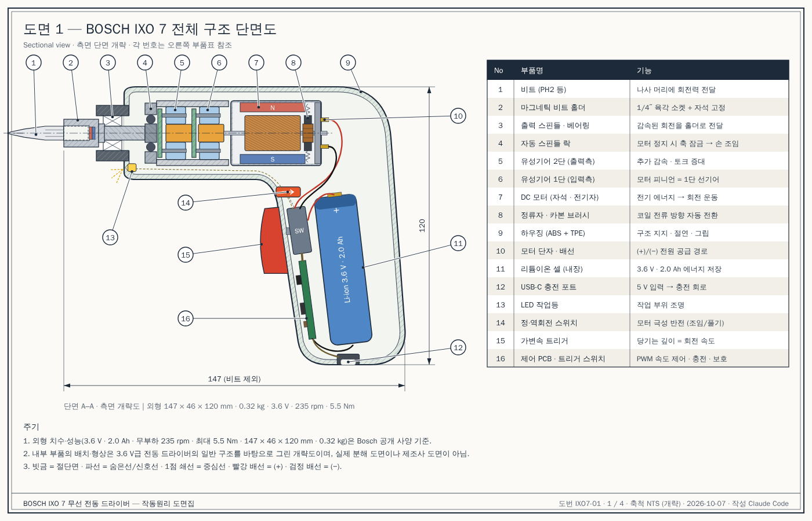

# BOSCH IXO 7 무선 전동 드라이버 — 작동원리와 도면

> 외형 치수와 성능 수치는 Bosch 공개 사양을 따랐다.
> 내부 부품 배치는 3.6 V급 전동 드라이버의 일반 구조를 바탕으로 그린 **개략도**다.
> 실제 분해 도면이나 제조사 도면이 아니다.

| 항목 | 값 |
|---|---|
| 배터리 | 3.6 V 리튬이온, 2.0 Ah (내장) |
| 무부하 회전수 | 최대 235 rpm (가변속) |
| 최대 토크 | 5.5 Nm (경질 체결) / 3 Nm (연질 체결) |
| 크기 · 무게 | 147 × 46 × 120 mm · 0.32 kg |
| 충전 | USB-C, 약 3시간 |
| 비트 고정 | 1/4″ 육각 마그네틱 비트 홀더 |

## 도면 목록

| 번호 | 도면 | 파일 |
|---|---|---|
| 1 | 전체 구조 단면도 (부품표 16개) | [SVG](ixo7-01-section.svg) · [PNG](png/ixo7-01-section.png) |
| 2 | 동력 전달 흐름도 · PWM · 극성 반전 · 속도-토크 | [SVG](ixo7-02-power-flow.svg) · [PNG](png/ixo7-02-power-flow.png) |
| 3 | 유성기어 감속 원리 | [SVG](ixo7-03-planetary-gear.svg) · [PNG](png/ixo7-03-planetary-gear.png) |
| 4 | 플렉시블 샤프트 어댑터 | [SVG](ixo7-04-flexible-shaft.svg) · [PNG](png/ixo7-04-flexible-shaft.png) |



## 작동원리 요약

에너지는 **배터리(전기) → 모터(회전) → 유성기어(감속) → 비트(나사 체결)** 순서로 흐른다.

1. **충전.** USB-C로 5 V가 들어오면 충전 회로가 리튬이온 셀을 정전류·정전압(CC/CV) 방식으로 4.2 V까지 채운다.
2. **가변속 트리거.** 트리거 스위치가 당긴 깊이를 읽는다. 제어 회로는 MOSFET를 아주 빠르게 켜고 끈다(PWM).
   켜져 있는 시간 비율(듀티)이 25 %면 모터에 걸리는 평균 전압은 약 0.9 V, 100 %면 3.6 V다.
   그래서 살짝 당기면 천천히, 끝까지 당기면 최대 235 rpm으로 돈다.
3. **정·역 전환.** 방향 스위치는 모터 두 단자에 들어가는 +/− 를 맞바꾼다.
   영구자석 DC 모터는 전류 방향이 바뀌면 회전 방향도 바뀐다. 그래서 조임과 풀기가 된다.
4. **DC 모터.** 전기자 코일에 흐르는 전류가 영구자석의 자기장 안에서 힘(로런츠 힘)을 받아 회전한다.
   정류자와 카본 브러시가 반 바퀴마다 코일 전류 방향을 바꿔 주므로 같은 방향으로 계속 돈다.
   모터는 빠르지만(약 1만 rpm대, 추정) 토크가 작다.
5. **유성기어 감속.** 링기어는 하우징에 고정돼 있다. 모터 축의 선기어가 돌면 유성기어 3개가 자전하면서 링을 따라 공전한다.
   공전하는 유성기어가 캐리어를 느리게 돌린다. 감속비는 1단에 `1 + Zr/Zs`(예: 36/12 → 4 : 1)다.
   여러 단을 이으면 감속비가 곱해진다. 회전수를 낮춘 만큼 토크가 커져 최대 5.5 Nm이 나온다.
   IXO 7의 실제 단수와 잇수는 비공개이며, 전체 감속비는 약 40~60 : 1로 추정된다.
6. **자동 스핀들 락.** 모터가 돌 때는 회전을 그대로 통과시킨다.
   모터가 멈추면 롤러가 캠과 잠금 링 사이에 끼어 축을 잠근다. 그래서 본체를 손 드라이버처럼 돌려 마지막 조임을 할 수 있다.
7. **비트 홀더.** 1/4″ 육각 소켓 바닥의 자석이 비트를 붙잡는다.
   같은 규격이라 플렉시블 샤프트 같은 어댑터를 바로 끼울 수 있다.

## 플렉시블 샤프트 어댑터

- **코어.** 강선을 층마다 반대 방향으로 감았다. 이 코어가 비틀림으로 토크를 전달한다.
  굽혀도 와이어끼리 미끄러지며 휘어지므로, 꺾인 상태로도 회전한다.
- **외피.** 세그먼트 외피와 라이너는 회전하지 않는다. 그래서 손으로 잡고 방향을 잡을 수 있다.
- **방향성.** 일반적인 플렉시블 샤프트는 외층이 감기는 방향(조임)에서 토크 용량이 더 크다.
- **주의.** 많이 굽힐수록 마찰 손실과 코어가 비틀렸다 풀리는 와인드업이 커진다.
  저속으로 쓰고, 최소 굽힘 반경보다 작게 꺾지 않는다.

## 도면 다시 만들기

모든 도면은 `gen_ixo7.py` 한 파일로 생성된다(파이썬 표준 라이브러리만 사용).

```bash
python3 gen_ixo7.py docs/bosch-ixo7
```
